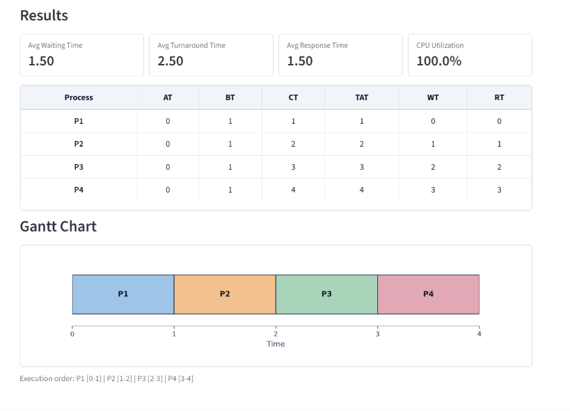
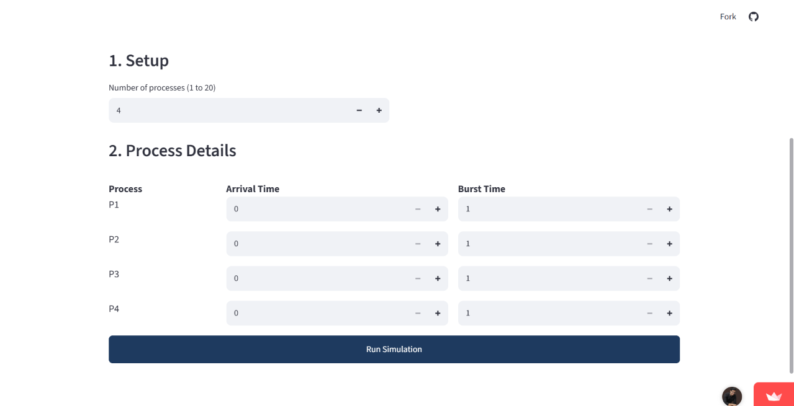

<!-- Header banner (animated). Free service: capsule-render -->
<p align="center">
  
</p>

<!-- Typing animation. Free service: readme-typing-svg -->
<p align="center">
  
</p>

<p align="center">
  <a href="https://rehman-cpu-scheduler.streamlit.app">
    
  </a>
</p>

<p align="center">
  
  
  
  
  
</p>

<p align="center">
  <a href="#about" style="text-decoration: none; display: inline-block; padding: 8px 16px; margin: 5px; background-color: #007bff; color: white; border-radius: 5px; font-family: sans-serif; font-weight: bold; transition: background 0.3s;">About</a> •
  <a href="#features" style="text-decoration: none; display: inline-block; padding: 8px 16px; margin: 5px; background-color: #007bff; color: white; border-radius: 5px; font-family: sans-serif; font-weight: bold; transition: background 0.3s;">Features</a> •
  <a href="#supported-algorithms" style="text-decoration: none; display: inline-block; padding: 8px 16px; margin: 5px; background-color: #007bff; color: white; border-radius: 5px; font-family: sans-serif; font-weight: bold; transition: background 0.3s;">Algorithms</a> •
  <a href="#preview" style="text-decoration: none; display: inline-block; padding: 8px 16px; margin: 5px; background-color: #007bff; color: white; border-radius: 5px; font-family: sans-serif; font-weight: bold; transition: background 0.3s;">Preview</a> •
  <a href="#getting-started" style="text-decoration: none; display: inline-block; padding: 8px 16px; margin: 5px; background-color: #007bff; color: white; border-radius: 5px; font-family: sans-serif; font-weight: bold; transition: background 0.3s;">Getting started</a>
</p>

---

## About

**CPU Scheduling Simulator** is a web app that shows how an operating system decides which process gets the CPU next. Choose an algorithm, enter the process details, and the app calculates the results and draws a Gantt chart for you.

It was built as a learning tool for Operating Systems. You can try different inputs and see right away how each algorithm behaves.

**Try it here:** [rehman-cpu-scheduler.streamlit.app](https://rehman-cpu-scheduler.streamlit.app)

## Features

- **6 scheduling algorithms** in one place
- **Smart input form.** Only the fields an algorithm needs are shown (for example Priority only for Priority scheduling, Time Quantum only for Round Robin)
- **Full results table:** Completion, Turnaround, Waiting and Response time for every process
- **Summary cards:** average waiting time, average turnaround time, average response time and CPU utilization
- **Gantt chart** with idle time shown when the CPU has nothing to run
- **Input validation** with clear error messages
- **Algorithms Guide** inside the app that explains how each algorithm works
- **Mobile friendly.** Process rows stay on one line, cards adapt to small screens, and wide tables scroll sideways

## Supported Algorithms

| Algorithm | Type | Inputs | Which process runs next |
|---|---|---|---|
| FCFS | Non-preemptive | AT, BT | The one that arrived first |
| SJF Non-Preemptive | Non-preemptive | AT, BT | Shortest burst time among arrived processes |
| SJF Preemptive (SRTF) | Preemptive | AT, BT | Shortest remaining time |
| Priority Non-Preemptive | Non-preemptive | AT, BT, Priority | Lowest priority number among arrived processes |
| Priority Preemptive | Preemptive | AT, BT, Priority | Lowest priority number, can interrupt the running process |
| Round Robin | Preemptive | AT, BT, Time Quantum | Next in the queue, each gets one time quantum |

> **AT** = Arrival Time, **BT** = Burst Time. For Priority scheduling, a **lower number means higher priority**. Ties are broken by earlier arrival, then by lower process number.

## Preview

<table>
  <tr>
    <td align="center"><b>Input form</b></td>
    <td align="center"><b>Results and Gantt chart</b></td>
  </tr>
  <tr>
    <td></td>
    <td></td>
  </tr>
</table>


**Formulas used**

| Term | Formula |
|---|---|
| Turnaround Time (TAT) | Completion Time - Arrival Time |
| Waiting Time (WT) | Turnaround Time - Burst Time |
| Response Time (RT) | First CPU start - Arrival Time |
| CPU Utilization | Total burst time / Total time x 100 |

<details>
<summary><b>Sample test cases (click to expand)</b></summary>

<br>

**SJF Preemptive (SRTF)**

| Process | AT | BT | CT |
|---|---|---|---|
| P1 | 0 | 8 | 17 |
| P2 | 1 | 4 | 5 |
| P3 | 2 | 9 | 26 |
| P4 | 3 | 5 | 10 |

Average TAT = 13.00, Average WT = 6.50

**Priority Preemptive** (lower number = higher priority)

| Process | AT | BT | Priority | CT |
|---|---|---|---|---|
| P1 | 0 | 5 | 3 | 12 |
| P2 | 1 | 4 | 1 | 5 |
| P3 | 2 | 2 | 4 | 14 |
| P4 | 3 | 3 | 2 | 8 |

Average TAT = 8.25, Average WT = 4.75

**Round Robin** (Time Quantum = 2)

| Process | AT | BT | CT |
|---|---|---|---|
| P1 | 0 | 5 | 13 |
| P2 | 1 | 3 | 12 |
| P3 | 2 | 1 | 5 |
| P4 | 3 | 2 | 9 |
| P5 | 4 | 3 | 14 |

Average TAT = 8.60, Average WT = 5.80

</details>

## Tech Stack

| Tool | Used for |
|---|---|
| Python | Scheduling logic |
| Streamlit | Web interface |
| Pandas | Building the results table |
| Matplotlib | Drawing the Gantt chart |

## Getting Started

**Requirements:** Python 3.9 or newer.

```bash
# 1. Clone the repository
git clone https://github.com/RehmanAhmad333/cpu-scheduler.git
cd cpu-scheduler

# 2. Create a virtual environment (optional but recommended)
python -m venv .venv
# Windows:        .venv\Scripts\activate
# macOS / Linux:  source .venv/bin/activate

# 3. Install the dependencies
pip install -r requirements.txt

# 4. Run the app
streamlit run app.py
```

The app opens at `http://localhost:8501`.

<details>
<summary><b>Project structure</b></summary>

```text
cpu-scheduler/
├── app.py                  # the whole app (logic + interface)
├── requirements.txt        # Python dependencies
├── README.md
├── .streamlit/
│   └── config.toml         # theme colour
└── assets/                 # images used in this README
    ├── screenshot-home.png
    └── screenshot-results.png
```

</details>

## Input Limits

| Field | Allowed range |
|---|---|
| Number of processes | 1 to 20 |
| Arrival Time | 0 to 1000 |
| Burst Time | 1 to 1000 |
| Priority | 0 to 1000 |
| Time Quantum | 1 to 1000 |

## Deployment

The app is hosted for free on **Streamlit Community Cloud**. Every `git push` to the `main` branch updates the live app automatically.

## Author

**Rehman Ahmad**

[](https://github.com/RehmanAhmad333)

## License

This project is open source under the MIT License.

If you found this project useful, please give it a star on GitHub.

<!-- Footer banner -->
<p align="center">
  
</p>
